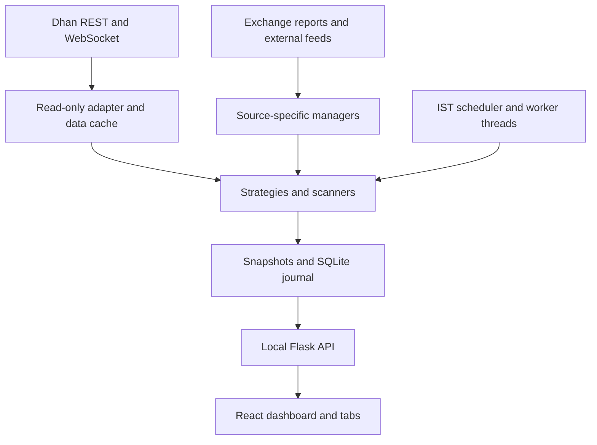

# Phase 1 — architecture at 147e27b35fe5

Audit date: 23 November 2026 (IST). Baseline: `feature/phase0-dhan-data-20261122`, commit `147e27b35fe5848f4ac8c460a5fe3d82d418f691`. This is the cumulative Phase 0 branch, not the older November 9 feature branch. Its head was rechecked during this audit.

**Documentation only. No runtime, strategy, configuration, dependency, schema or UI changes.** See [AUDIT.md](AUDIT.md) for findings and [VALIDATION.md](VALIDATION.md) for reproduction and verification limits. Phase 2 and Phase 3 are not implemented by this change.

## Runtime and data flow

The web launcher loads local environment settings, starts a threaded loopback Werkzeug server and the Insights service. The older desktop engine still exists; its indicators and execution assumptions are not identical to the web app. It is not the default execution path of the web launcher.

Evidence: [run_insights.py:1](https://github.com/aadi5279-aptransco/Bharatfusion-signal/blob/147e27b35fe5848f4ac8c460a5fe3d82d418f691/run_insights.py#L1), [insights/service.py:57](https://github.com/aadi5279-aptransco/Bharatfusion-signal/blob/147e27b35fe5848f4ac8c460a5fe3d82d418f691/insights/service.py#L57), [engine.py:1](https://github.com/aadi5279-aptransco/Bharatfusion-signal/blob/147e27b35fe5848f4ac8c460a5fe3d82d418f691/engine.py#L1).

## Sources and boundaries

| Source | Consumers and purpose | Current trust boundary |
|---|---|---|
| Dhan detailed instrument master | Equity/index/sector identity, futures, options; official master cached daily | Mapping is not a full exchange eligibility/ban/calendar check. BANKNIFTY futures mapping remains unresolved in the user's report. |
| Dhan historical REST | OHLCV and OI; 1/5/15/25/60-minute and daily requests | Month partitions <=31 days; SQLite cache; structural validation and quarantine summaries; prices explicitly AS REPORTED, adjustment unverified. |
| Dhan expiry list / option chain | Available expiries/strikes, OI/PCR/max pain, premium quotes | Index premium path separately validates quote timestamps/depth; legacy Analyse and F&O scenarios explicitly have unverified quote age. |
| Dhan market quotes / depth | Liquidity shortlist and resting-book evidence | Session volume and price are proxies for liquidity; retrieval timestamp is not last-trade freshness. |
| Dhan WebSocket | Index futures inferred order flow | Prior-book/tick-rule inference; connection-segment CVD, unknown-volume accounting and feed-gap reset; not exchange-certified aggressor delta. |
| Nifty index constituent CSV | Intraday and Positional NIFTY 500 membership | Current constituents with bounded cache; no historical membership archive demonstrated. |
| NSE participant reports | Aggregate participant positioning | Aggregate index/derivative positioning cannot identify each stock bought by FIIs. |
| NSE bulk/block reports + local verified-FPI registry | Disclosed foreign-client stock transactions | Only documented registry matches counted; unmatched clients not silently classified as FII. Registry proof is user supplied. |
| Screener shareholding pages / imported CSV | Quarterly FII ownership changes | Consecutive quarters, change in percentage points; neither daily buy/sell quantities nor proof of trade direction. |
| Local fundamentals, surveillance and scanner metadata files | Multibagger/QGLP and optional filters | Date/source envelopes and numerical checks; values not independently reconciled to filings. |
| Yahoo chart endpoint | EU index display | Separate free-feed worker; provider delay and exchange-calendar completeness not certified. |
| PIB/RBI/Fed/ECB/BBC RSS and BLS ICS | News/event notifications | Source-level parsing and local notification database; news freshness/impact is heuristic. Event API and workers remain although calendar navigation was removed. |

Evidence: [insights/brokers/dhan.py:142](https://github.com/aadi5279-aptransco/Bharatfusion-signal/blob/147e27b35fe5848f4ac8c460a5fe3d82d418f691/insights/brokers/dhan.py#L142), [insights/data_layer/history.py:14](https://github.com/aadi5279-aptransco/Bharatfusion-signal/blob/147e27b35fe5848f4ac8c460a5fe3d82d418f691/insights/data_layer/history.py#L14), [insights/data_layer/master.py:14](https://github.com/aadi5279-aptransco/Bharatfusion-signal/blob/147e27b35fe5848f4ac8c460a5fe3d82d418f691/insights/data_layer/master.py#L14), [insights/nifty500.py:88](https://github.com/aadi5279-aptransco/Bharatfusion-signal/blob/147e27b35fe5848f4ac8c460a5fe3d82d418f691/insights/nifty500.py#L88), [insights/fii_stock_deals.py:107](https://github.com/aadi5279-aptransco/Bharatfusion-signal/blob/147e27b35fe5848f4ac8c460a5fe3d82d418f691/insights/fii_stock_deals.py#L107), [insights/fii_holdings.py:68](https://github.com/aadi5279-aptransco/Bharatfusion-signal/blob/147e27b35fe5848f4ac8c460a5fe3d82d418f691/insights/fii_holdings.py#L68), [insights/europe_markets.py:50](https://github.com/aadi5279-aptransco/Bharatfusion-signal/blob/147e27b35fe5848f4ac8c460a5fe3d82d418f691/insights/europe_markets.py#L50), [insights/event_center.py:13](https://github.com/aadi5279-aptransco/Bharatfusion-signal/blob/147e27b35fe5848f4ac8c460a5fe3d82d418f691/insights/event_center.py#L13).

## Signal logic by tab

| Tab / component | Current calculation path | Inputs and outputs |
|---|---|---|
| Dashboard | service.dashboard → dashboard_trend.add_features | 5m EMA20/50/200, EMA slope, directional ADX and prior-20-bar breakout. Signed score; ±40 threshold. Technical trend is distinct from day-change points. EU status is a separate worker. |
| Analyse | analyse_workflow → analyse_engine, atm_recommendation, smc_expert, options.chain_metrics | Cash/index 5/15/60m; confirmed-pivot BOS/CHoCH, sweep/displacement/FVG/order-block proxies; separate option premium history for levels. Heuristic expert system, not trained AI. Legacy PCR-gated scenario remains separately labelled. |
| Pre-Market 8AM | scan_premarket → premarket_setups; PremarketFollowthrough worker | Frozen prior-completed-session candidates; post-09:30 completed 5m follow-through, daily/15m context and opening-range/red-bar/Fibonacci checks. Buy/sell research plans remain separate. |
| Intraday | stored liquidity list → momentum_query → ai_rank → cycle_wave → journal | Eight running-daily conditions and three completed-15m conditions; 5m trigger/ATR/structure stop; heuristic ranking, buy/sell lists and combined top ten. Current nullable-confidence integration defect is finding F01. |
| BTST | equity.btst, advanced_smc.btst_confirm; btst_closing | Daily/intraday breakout/volume and higher-timeframe checks; closing-session research overlays, conditional levels and warnings. Not a settlement/delivery guarantee. |
| Index Options | opening_redbar / Fibonacci watch logic → index_premium; IndexOrderFlow overlay | Closed 5m/15m plus 60m context, two-close hold/rejection checks; actual ATM option bid/ask and premium levels; CE and PE independently assessed. Futures order-flow levels are explicitly not option premiums. |
| F&O Stocks | futures.buildup + advanced_smc → options.option_plan → fo_selection | Futures price/OI, cash breakout/RVOL and 15/60m alignment; ATM premium scenarios, spread checks; at most eight unique underlyings; conflicting directions excluded. Not eight guaranteed winners. |
| Swing Trades | scan_longterm / shortlist monitoring → swing, swing_opportunities, swing_guide, swing_gann_wave | Daily trend/pullback/consolidation, RSI, Supertrend and other research overlays; daily/weekly context and relative-strength ranking. Shared math is not yet centralized. |
| Positional | PositionalScanner → daily_setups, r1_setups, EMA9Scanner | Morning Star, Supertrend+RSI, Donchian, Moving Momentum, R1 and EMA9 trendline research; daily/hourly/weekly/monthly eligibility handled in separate functions. |
| Scanner | StockScanner | Completed daily cached rows, user-selected filters/sort/page/export and optional metadata. Screening rows are not automatically executable signals. |
| Multibagger | multibagger.evaluate + QGLPResearch | Daily/weekly/monthly trend and dated fundamentals/surveillance; QGLP relative ranking with missing/stale fields blocked. No audited trained return model. |
| FII views | FIIStockDeals / FIIHoldings / participant manager | Separate disclosed client deals, quarterly ownership changes and aggregate positioning. Do not merge these into one daily stock-flow interpretation. |
| Track Record | Journal + reconcile_outcomes | Only selected service paths call Journal.record; not every tab's displayed plan is recorded. 5m target/SL observation, stop-first ties, 75-bar timeout. Entry-fill/cost/provenance limitations in F02–F04/F18. |
| Notifications | EventCenter | Trade rows collected from service snapshots; deduplicated persisted alerts and read markers. Separate from the signal outcome journal. |

Evidence: [insights/service.py:443](https://github.com/aadi5279-aptransco/Bharatfusion-signal/blob/147e27b35fe5848f4ac8c460a5fe3d82d418f691/insights/service.py#L443), [insights/service.py:991](https://github.com/aadi5279-aptransco/Bharatfusion-signal/blob/147e27b35fe5848f4ac8c460a5fe3d82d418f691/insights/service.py#L991), [insights/service.py:1035](https://github.com/aadi5279-aptransco/Bharatfusion-signal/blob/147e27b35fe5848f4ac8c460a5fe3d82d418f691/insights/service.py#L1035), [insights/service.py:1098](https://github.com/aadi5279-aptransco/Bharatfusion-signal/blob/147e27b35fe5848f4ac8c460a5fe3d82d418f691/insights/service.py#L1098), [insights/dashboard_trend.py:6](https://github.com/aadi5279-aptransco/Bharatfusion-signal/blob/147e27b35fe5848f4ac8c460a5fe3d82d418f691/insights/dashboard_trend.py#L6), [insights/analyse_workflow.py:54](https://github.com/aadi5279-aptransco/Bharatfusion-signal/blob/147e27b35fe5848f4ac8c460a5fe3d82d418f691/insights/analyse_workflow.py#L54), [insights/positional.py:71](https://github.com/aadi5279-aptransco/Bharatfusion-signal/blob/147e27b35fe5848f4ac8c460a5fe3d82d418f691/insights/positional.py#L71).

## Scheduling and concurrency

| Job | Trigger / cadence | Coordination |
|---|---|---|
| Main service | Loop waits 20 seconds after work finishes | One process-local job lock serializes broad scans; not a fixed-rate 20-second scheduler. |
| Index options | From 09:20, one run per five-minute bucket with catch-up | Runs before broad liquidity discovery. |
| Broad liquidity discovery | 09:45, 10:00, 11:00, 12:00, 13:00, 14:00, 15:00 IST | Quotes broad universe, persists bounded lists; subsequent strategy scans use stored names. Failure retry issue F13. |
| Intraday / F&O / Swing monitor | From 09:45, five-minute buckets | Slots marked done before these jobs run; F12. |
| Dashboard / outcomes | Five-minute refresh only when minute modulo five is zero | Can miss a bucket after long work; F12. |
| BTST | 14:30 closing preview; 15:00 BTST; 15:05 confirmation; 15:20 final | Late-start logic avoids replaying obsolete previews. |
| Daily long-term / premarket | After 15:40; morning from 08:00; off-hours preparation | Uses completed-session checks and saved watchlist; calendar limitations apply. |
| Premarket follow-through | Worker polls and requests five-minute slots after 09:30 | Frozen watchlist, completed grids, retry budget, stale suppression. |
| Positional / Scanner | Separate worker / requested scan | Shared broker access lock around calls; scanner supports cancellation. |
| Order flow / EU / news | Independent threads and source refresh loops | Reduces scan coupling; full-load latency and shutdown soak unverified. |
| UI | Health ~15s, main snapshots ~20s; component-specific polls | Does not itself guarantee fresh source data or a successful backend scan. |

Evidence: [insights/service.py:1309](https://github.com/aadi5279-aptransco/Bharatfusion-signal/blob/147e27b35fe5848f4ac8c460a5fe3d82d418f691/insights/service.py#L1309), [insights/service.py:1472](https://github.com/aadi5279-aptransco/Bharatfusion-signal/blob/147e27b35fe5848f4ac8c460a5fe3d82d418f691/insights/service.py#L1472), [insights/liquidity_shortlist.py:7](https://github.com/aadi5279-aptransco/Bharatfusion-signal/blob/147e27b35fe5848f4ac8c460a5fe3d82d418f691/insights/liquidity_shortlist.py#L7), [web/src/main.js:957](https://github.com/aadi5279-aptransco/Bharatfusion-signal/blob/147e27b35fe5848f4ac8c460a5fe3d82d418f691/web/src/main.js#L957).

## Storage

Default root is the user's home `.bharatsignal-insights` directory (configuration may override it). Dhan credentials are local configuration; they must not be included in audit uploads.

| Store | Owner / contents |
|---|---|
| insights.sqlite | Signals, outcome fields, latest per-strategy backtest result; WAL and per-operation connections |
| Transport SQLite | Request quota accounting, official master, historical chunks, quality metadata and quarantine hashes/array lengths |
| premarket_watch.json and dated archives | Prior-session watchlist and reproducibility context |
| liquidity_shortlists.json | Same-day discovery state, selected instruments and coverage |
| NIFTY 500 cache | Source CSV, retrieval date, current mapping coverage |
| Scanner/FII SQLite stores | Persisted rows, metadata, disclosures/holdings snapshots |
| qglp_import.json | Dated user-supplied research import |
| event_notifications.sqlite | News/events, notification identity and read state |
| In-memory state | Service snapshots, request caches, done-job set, order-flow deque and worker status |

Not all stores have retention policies, append-only history or cross-process coordination. A saved snapshot is not equivalent to a point-in-time research dataset.

## APIs and UI

Flask serves built React/Vite assets and JSON under `/api/v1/market-insights/`. Read endpoints include module snapshots, Analyse, Scanner, Positional, QGLP, FII, Europe, order flow, notifications, readiness and Track Record. Mutating endpoints request refresh/cancel/import or mark alerts read. The app-control API provides a token-protected local exit.

Request size limits, CSP, frame denial, no-sniff and no-store headers exist. Same-origin protection currently covers only a subset of POST routes (F14). This remains a read-only broker application: no authorized broker-order execution path is added here.

UI includes Indian currency formatting via `en-IN`, several explicit IST conversions, loading/empty/error messaging and research-only labels. Some cards render raw ISO times rather than a consistent formatted IST label. Navigation clears old data; that is **not** reported as a stale-tab-data defect.

## Phase boundaries

- Phase 1 delivers the map, findings, reproduction recipes and unresolved verification register.
- Phase 2 would centralize deterministic, typed, configured patterns and temporal contracts. Existing rule implementations are not a complete Phase 2 engine.
- Phase 3 requires point-in-time adjusted history, realistic fill/cost labels, leak-free validation and paper-forward evidence. Existing heuristic “AI” scores must not be treated as calibrated P(success).
- Approval to review this report is not approval to silently repair runtime behaviour. No fixes or model promotions are included.
